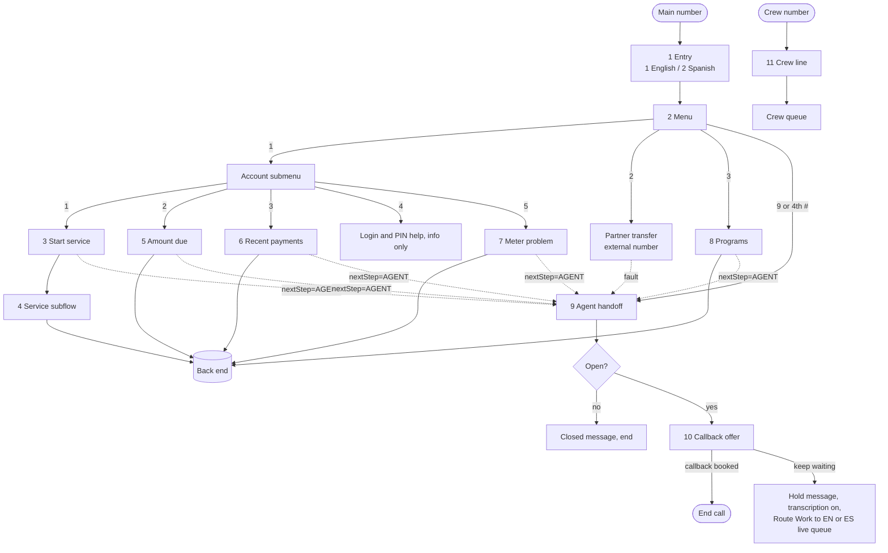

# Worked example: a complete IVR, flow by flow

A full keypad IVR for a made-up **City Water & Power** customer line (client key `CITY`), built from the blueprints in `flow-catalog.md`. Every flow a production line typically needs is here, each with its keys, steps, outputs, saved fields, fault paths and test scenarios. Copy the shape for a real client, then change the prompts, factors, Apex operations and queues.

All names, numbers and prompts are invented. Synthetic test data: phone `2025550100`, account `0000000001`, ZIP `00000`.

## Flow list

| # | Flow | Type | Blueprint | Business scenario |
|---|---|---|---|---|
| 1 | `IVR_CITY_Entry` | Routing | Entry | Welcome, language choice |
| 2 | `IVR_CITY_EN_Menu`, `IVR_CITY_ES_Menu` | Routing subflow | Menu + submenu | Main menu and account submenu |
| 3 | `IVR_CITY_EN_Start_Service`, `_ES_` | Routing subflow | Enrolment with acknowledgements | Start service at a new address |
| 4 | `IVR_CITY_Start_Service_Service` | Autolaunched | Service subflow | Wraps the start-service Apex call for both languages |
| 5 | `IVR_CITY_EN_Amount_Due`, `_ES_` | Routing subflow | Look up and read back | Amount due and due date |
| 6 | `IVR_CITY_EN_Recent_Payments`, `_ES_` | Routing subflow | Look up a list | Last three payments |
| 7 | `IVR_CITY_EN_Meter_Problem`, `_ES_` | Routing subflow | Request with a reason | Damaged or stolen meter: lock, confirm address, order replacement |
| 8 | `IVR_CITY_EN_Programs`, `_ES_` | Routing subflow | Look up and read back | Assistance and savings programs the account is enrolled in |
| 9 | `IVR_CITY_Agent_Handoff` | Routing subflow | Agent handoff | Every live-agent path; hours, hold, queue per language |
| 10 | `IVR_CITY_EN_Callback_Offer` | Routing subflow | Callback offer | Callback when all agents are busy |
| 11 | `IVR_CITY_Crew_Line` | Routing | Direct line | Separate number for field crews, straight to agents |
| 12 | `IVR_CITY_Callback_Close`, `IVR_CITY_Callback_Withdraw` | Record-triggered | Callback cleanup | Close a request after the agent calls back; withdraw it if the caller gets through first |
| 13 | `IVR_CITY_Talk_Time` | Record-triggered, scheduled path | Talk time | Fill talk time from recordings |
| 14 | Post-call summary (shared) | Record-triggered, async | AI summary | Summary for agent-handled calls with a transcript |

Menu options without their own flow: **2 → partner transfer** (external transfer), **1-4 → login and PIN help** (information only), **9 → agent**.

## Call chain

---

## 1. Entry: `IVR_CITY_Entry`
| Step | Element | Detail |
|---|---|---|
| 1 | Set Recording and Transcription Behavior | recording allowed, transcription off; fault → continue |
| 2 | Update VoiceCall | `IVR_Client__c = CITY`; fault → continue |
| 3 | Prompt (message) | "Thanks for calling City Water and Power." |
| 4 | Prompt `Ask_Language_EN` + `Ask_Language_ES` | "For English, press 1." / "Para español, oprima 2." All keys, length 1, 8 s |
| 5 | Decision | 1 → `languageCode=en`; 2 → `es`; wrong key → "That isn't an option" (once); silence → "We didn't hear a choice" (once); then English |
| 6 | Update VoiceCall | `IVR_Language__c`; fault → continue |
| 7 | Subflow | `IVR_CITY_EN_Menu` or `IVR_CITY_ES_Menu` (input `recordId`, `languageCode`) |
| 8 | End call | after the menu returns |

**Tests:** press 1 → English menu · press 2 → Spanish menu · press 7 then 1 → wrong-key message, English · silence twice → English menu.

## 2. Menu: `IVR_CITY_EN_Menu` (Spanish copy identical in structure)
**Main prompt:** "For your account and bills, press 1. For home appliance rebates, press 2. For assistance and savings programs, press 3. To speak with a representative, press 9. To hear this again, press pound."

| Key | Goes to | `menuSelection` |
|---|---|---|
| 1 | Account submenu | `1|Account` |
| 2 | "We'll connect you to our rebate partner." → external transfer (`fromNumber` = line, `toNumber` from config); fault → agent handoff | `2|Partner Transfer` |
| 3 | `IVR_CITY_EN_Programs` → `Next_Step_Router` | `3|Programs` |
| 9 | Agent handoff | `9|Agent` |
| # | repeat; the 4th `#` → agent handoff | `#|Repeat` |
| other / none | wrong-key or no-input message, 1 retry, then "Goodbye" → end | – |

**Account submenu:** "To start service, press 1. For your amount due, press 2. For recent payments, press 3. For login and PIN help, press 4. To report a meter problem, press 5. For the main menu, press 0."

| Key | Goes to | `menuSelection` |
|---|---|---|
| 1 | `IVR_CITY_EN_Start_Service` | `1|1|Start Service` |
| 2 | `IVR_CITY_EN_Amount_Due` | `1|2|Amount Due` |
| 3 | `IVR_CITY_EN_Recent_Payments` | `1|3|Recent Payments` |
| 4 | Information: "You can reset your login or PIN online at our website. Press 0 for the main menu." 0 → menu, else end | `1|4|Login Help` |
| 5 | `IVR_CITY_EN_Meter_Problem` | `1|5|Meter Problem` |
| 0 | main menu | – |

**`Next_Step_Router`** after every feature: `MAIN_MENU` → reset counters → main menu; `AGENT` → agent handoff (pass `languageCode`, `menuSelection`); else end. Save `IVR_Menu_Selection__c` before each target (fault → continue).

**Tests:** 1-2 → amount due · 2 → transfer (and a forced transfer fault → agent) · 3 → programs · 9 → agent · `#` ×4 → agent · 5 → wrong key, retry, 9 → agent · silence ×2 → goodbye.

## 3. Start service: `IVR_CITY_EN_Start_Service` (enrolment with acknowledgements)
| Step | Prompt / action | Rules |
|---|---|---|
| Gate 1 | "Before we start, please listen to our service terms… Press 1 to continue." | 1 → gate 2; other/none → repeat once → `AGENT` |
| Gate 2 | "A refundable deposit may apply. Press 1 to agree, or 2 to speak with a representative." | 1 → continue; 2 → `AGENT`; other/none → repeat once → `AGENT` |
| Factor A | "Enter your move-in date as two-digit month, two-digit day and four-digit year." `*`, length 8, 15 s | `f_startDateOk`; invalid → message, ask again; 3 invalid → `AGENT`; silence ×2 → `AGENT` |
| Confirm A | "You entered {!f_dateReadBack}. Press 1 if that's right, 2 to re-enter." | 2 → ask again |
| Factor B | "Enter the five-digit ZIP code of the new address." `*`, length 5, 10 s | `f_zipOk`; same counters |
| Confirm B | read back digit by digit | 2 → ask again |
| Submit | Subflow `IVR_CITY_Start_Service_Service` (clientKey, date, ZIP) | outputs `status`, `errorCode` |
| Save | Update VoiceCall `IVR_Start_Service_Status__c`, `IVR_Start_Service_Error__c` | fault → continue |
| Success | "Your request is in. Press 0 for the main menu." | 0 → `MAIN_MENU`; else `END` |
| Not success | "Sorry, we couldn't complete that. Press 0 for the main menu, or 1 for a representative." | 0 → `MAIN_MENU`; anything else or silence → `AGENT` |

**Tests:** 1,1,valid date,1,valid ZIP,1 → success → 0 → menu · gate 2 press 2 → agent · 3 invalid dates → agent · confirm 2 → re-entry works · Apex returns error → help menu → silence → agent · Apex fault → help menu.

## 4. Service subflow: `IVR_CITY_Start_Service_Service`
Inputs `clientKey`, factors. Apex `Voice: Start service` → `status` (`OK` | `FAILED` | `ERROR`), `errorCode` (`INVALID_INPUT`, `NOT_FOUND`, `BACKEND_ERROR`, `SYSTEM_ERROR`). Apex fault → `status=ERROR`. No prompts, no record updates; both language flows call it.

## 5. Amount due: `IVR_CITY_EN_Amount_Due` (look up and read back)
Account number (`*`, 10) + confirm → ZIP (`*`, 5) + confirm → Apex `amountDue` → speak "Your amount due is … due on …" (the `speech` output) → "Press 0 for the main menu" → `MAIN_MENU` / `END`. Error → help menu. Save status / error code (never the amount).

**Tests:** happy path · wrong ZIP (`NOT_FOUND`) → help menu → 1 → agent · silence on account ×2 → agent.

## 6. Recent payments: `IVR_CITY_EN_Recent_Payments` (look up a list)
Account number + confirm → phone number on the account (`*`, 10) + confirm → Apex `recentPayments` → read the last **3** (date and amount each, capped by Apex) → 0 menu. No payments → "We don't see any recent payments." → 0 menu.

**Tests:** three payments read · zero payments message · back-end error → help menu.

## 7. Meter problem: `IVR_CITY_EN_Meter_Problem` (request with a reason)
| Step | Rules |
|---|---|
| Account + phone, each confirmed | as above |
| Reason menu | "If your meter is damaged, press 1. If it's missing or tampered with, press 2." other/none → retry once → `AGENT` |
| Address check | Apex `serviceAddress` → "We have your service address as {street number and street}. Press 1 if that's right, 2 if not." 2 → `AGENT` (never let the caller change an address by keypad) |
| Protective step (reason 2 only) | Apex `lockMeter`; failure → `AGENT` before anything else |
| Confirm | "We'll schedule a replacement. Press 1 to confirm." other → `AGENT` |
| Order | Apex `orderReplacement` → success "Done. A technician will contact you." → 0 menu; failure → help menu |

Read back only the minimum (street number and name, no unit or city) and only after both factors match.

**Tests:** reason 1 → address 1 → confirm → success · reason 2 → lock then order · lock fails → agent · address 2 → agent · order fails → help menu.

## 8. Programs: `IVR_CITY_EN_Programs` (look up and read back)
Account number + phone, confirmed → Apex `programs` → "You're enrolled in: …" or "You're not enrolled in any programs. To hear about them, press 9." → 0 menu / 9 `AGENT`.

## 9. Agent handoff: `IVR_CITY_Agent_Handoff`
1. Update VoiceCall: language, menu selection. Fault → continue.
2. Apex `Voice: Is the line open` with `CITY Business Hours` (Mon–Fri 08:00–20:00, holidays on the record). Fault → treat as open.
3. Closed → "Our office is closed. We're open Monday to Friday, 8 AM to 8 PM." (EN/ES) → end.
4. Open, English and callbacks enabled → subflow `IVR_CITY_EN_Callback_Offer`; `callbackRequested=true` → end.
5. "Please hold for the next representative." → `disableRecAndTranscription` false/false (fault → continue) → Route Work QueueBased `sfdc_phone`: `languageCode=en` → **CITY EN Live** (fixed), `es` → **CITY ES Live** (fixed).
6. Route Work fault → "Sorry, we can't connect you right now. Please call again." → end.

**Tests:** inside hours EN → EN queue · ES → ES queue · outside hours → closed message · hours Apex fault → still queued · agents busy → callback offer.

## 10. Callback offer: `IVR_CITY_EN_Callback_Offer`
Exactly the `callbacks.md` path: availability check on CITY EN Live → busy → hold message with a listen window → check again → "Press 1 to keep waiting, 2 for a callback" → number entry (10 digits, read back, confirm) → Apex `reserve` → Route Work to **CITY EN Callback** (Contact Request, fixed queue) → `removeOlder` → "We'll call you back." → `callbackRequested=true`. Every fault → `false`.

**Tests:** agent free → no offer · busy, press 1 → keep waiting · busy, press 2, number, 1 → request in callback queue · same number twice → one open request · callback queue missing Contact Request → falls back to live queue.

## 11. Crew line: `IVR_CITY_Crew_Line`
Own number. English only. Hours check (fail open) → closed: "The crew desk is closed. Use the crew portal for non-urgent requests." → end. Open: "This call may be recorded." → transcription on → Route Work to **CITY Crew** queue. No menu.

## 12. Callback cleanup (record-triggered on VoiceCall)
| Flow | Trigger | Entry criteria | Action |
|---|---|---|---|
| `IVR_CITY_Callback_Close` | create | Outbound, `ToPhoneNumber` set, `FromPhoneNumber` = CITY caller ID | Apex `closeByNumber` (client CITY) → `Contacted` |
| `IVR_CITY_Callback_Withdraw` | update, only when changed | Inbound, `CallAcceptDateTime` set, `IVR_Client__c = CITY` | Apex `withdrawByNumber` (client CITY) → `Abandoned` |

## 13. Talk time: `IVR_CITY_Talk_Time`
After-save on VoiceCall create/update, only when changed, `CallEndDateTime` set and the call to or from a CITY number. Scheduled path **2 minutes after `CallEndDateTime`** → Apex sums `VoiceCallRecording.DurationInSeconds` → talk-time field. No recording → leave as is. Fault → keep the message.

## 14. Post-call summary (shared)
Update trigger, `CallAcceptDateTime` set, async-after-commit → get transcript → stop if blank → prompt template → save the summary text after "Summary:" only when it's a real summary. One flow serves every client.

---

## End-to-end test plan (live, inside hours, synthetic numbers)
| # | Scenario | Keys | Expect |
|---|---|---|---|
| 1 | English amount due | 1, 1, 2, account, 1, ZIP, 1 | amount read, 0 → menu |
| 2 | Spanish amount due | 2, 1, 2, … | same in Spanish |
| 3 | Start service happy path | 1, 1, 1, 1, 1, date, 1, ZIP, 1 | "request is in" |
| 4 | Start service, declines deposit | 1, 1, 1, 1, 2 | agent queue |
| 5 | Meter stolen | 1, 1, 5, account, 1, phone, 1, 2, 1, 1 | lock + replacement |
| 6 | Partner transfer | 1, 2 | partner line rings |
| 7 | Programs, none enrolled | 1, 3, …, 9 | agent queue |
| 8 | Agent, English | 1, 9 | EN live queue, transcription on, recording |
| 9 | Agent, Spanish | 2, 9 | ES live queue |
| 10 | Repeat to agent | 1, #, #, #, # | agent queue |
| 11 | Closed hours | 1, 9 after hours | closed message |
| 12 | Callback | 1, 9 with all agents busy, 2, number, 1 | request in callback queue; agent calls back; request `Contacted` |
| 13 | Crew line | dial crew number | crew queue |
| 14 | Post-call | after #8 | recording, talk time after ~2 min, summary |

After each call: VoiceCall disposition, AgentWork, recording count, transcript entry count (flags only, `diagnostics.md`).
